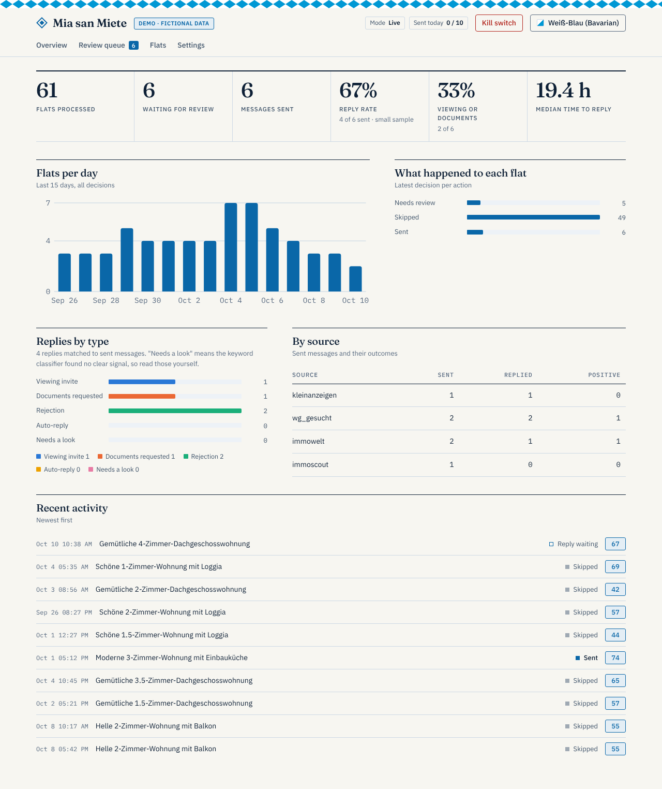
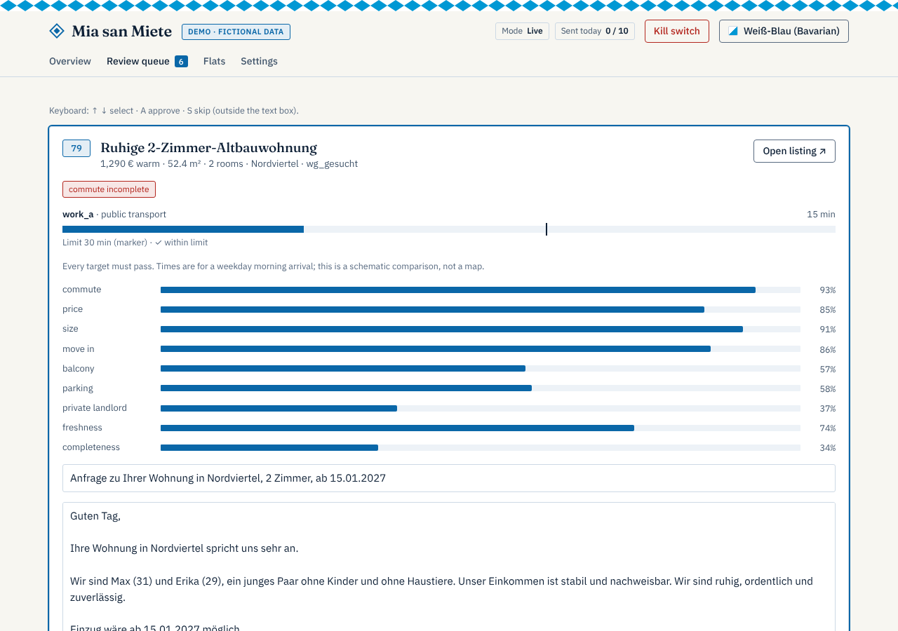

<p align="center"></p>

# Mia san Miete

[](https://github.com/Telschow/mia-san-miete/actions/workflows/ci.yml)
[](LICENSE)

*Servus!* Mia is a personal agent for the German rental market. It reads your portal alert
emails, filters and scores every flat with fixed rules, drafts a truthful message, and sends
only under an explicit, capped policy, with you in control. Shadow mode and a kill switch are
the default.

The name is a Bavarian pun on *Mia san mia* ("we are who we are"). The tool itself is not tied
to Munich or to one person: ten large cities and four household types ship as presets.

<p align="center"></p>

<p align="center"><sub>Weiß-Blau theme with fictional demo data. Paper, Slate, Bayern Nacht and High contrast are included.</sub></p>

**What it does:** finds, scores and drafts. **What it does not do:** log in to portals or send
through them. You send from the portal yourself, or approve the email path in the queue.

**New here? Start with the [how-to guide](docs/how-to.md)**, which takes you from a fresh clone to a supervised shadow run.

## Personalize it (nothing personal is ever committed)

Fastest: run `mia init`. It asks a few questions, validates the answers and writes the files
below (plus `.private-terms` and the env file); sending stays disabled and shadow mode on.

Everything about you lives in two gitignored files:

| File | Holds |
|---|---|
| `config.yaml` | city, budget, size, move-in window, commute targets, send policy |
| `profile/profile.yaml` | names, phone, the facts a message may state, viewing times |

```bash
cp config.example.yaml config.yaml
cp profile/profile.example.yaml profile/profile.yaml
```

- **Other city:** set `city.name`, use `pt_router: motis` (covers all of Germany), and replace
  the commute `targets` with your own places. Targets are generic: any number, each with a
  public-transport and/or car limit, combined with `all` or `any`.
- **Other life situation:** edit the facts in your profile. The generator can only state facts
  listed there, in German and English.
- **Other search criteria:** every limit and exclusion keyword is in `config.yaml`.

## Keeping private data out of GitHub

1. Put your own sensitive terms (employers, addresses, income figures, names) one per line in
   `.private-terms` (gitignored, never pushed).
2. `mia install-hook` installs a pre-commit hook that runs `mia check-private`. It blocks a
   commit if any tracked file contains one of your terms, an email address, a mobile number
   or an IBAN. Reports show file and line only, never the matched text.
3. The test suite also runs the generic part of this scan over the repository.

Fixtures, tests and example files use fictional data only.

## Status

Built: alert-email discovery, hard gates, configurable commute (MOTIS router, all of Germany),
optional area radius and walking time to the nearest stop, deterministic score, message
generator with validator and template fallback, send policy (shadow mode default, caps, quiet
hours, kill switch, duplicate guard) with a content-free audit trail, approval queue, reply
monitor and metrics, opt-in auto-reply, a local dashboard (themes, settings editor, first-run
setup), `mia init` with city and household presets, benchmarks on fictional data, CI.

Not built: sending through portals. Mia finds, scores and drafts; you send from the portal
yourself (the dashboard has "Copy message" and "Open listing"). Semi-automatic and automatic
portal sending are only evaluated in `docs/adr/0006-*`. Plan and open work: `docs/roadmap.md`.

Publishing the repository: `docs/publishing.md`. Security reports: `SECURITY.md`.

## Design in one paragraph

Triggers (portal alert emails, pollers, manual forwards) feed a pipeline:
fetch, normalize, dedup, hard gates, commute, score, then decision (auto-send, needs
approval, skip). The LLM only writes one or two listing-specific sentences; a validator
checks the draft against an allow-list of facts and falls back to a fixed template. The
score is deterministic and never influenced by an LLM.

## Setup

```bash
python -m venv .venv && . .venv/bin/activate
pip install -e ".[dev]"
mia check-config config.yaml
mia install-hook
pytest
```

## Automatic reply to viewing offers (opt-in, off by default)

When a landlord offers a viewing, Mia can answer for you. Everything below is disabled until
you add it to `config.yaml` / `profile.yaml` (commented examples are in the `*.example.yaml`
files). Details and limits: `docs/adr/0004-opt-in-auto-reply-and-local-llm.md`.

1. Add your weekly `availability` windows to `profile/profile.yaml`.
2. Add `auto_reply: {enabled: true, mode: shadow}` to `config.yaml`. In **shadow** mode it only
   logs what it would confirm. Check the `auto_replies` outcomes for a while, then switch to
   `mode: live`.
3. `mia check-replies` (run by the scheduler) does the rest: a slot that fits your windows is
   confirmed; anything else is drafted into the review queue (kind "Reply to landlord") for one
   click. The text is a fixed template with only your own free times, names and phone.
4. Optional: `reply_llm` lets a **local** model (Ollama or any local OpenAI-compatible server;
   hosted endpoints are rejected) label replies the keyword rules cannot place and suggest
   slots. Without it, the rule-based parser alone is used.

Guards: kill switch, quiet hours, daily cap, one automatic reply per thread, never to
automatic mail, mailing lists or your own address.

## Search area, presets and the config reference

- Optional area limits: postcodes and districts, a straight-line radius around a center, and the
  walk to the nearest metro, S-Bahn or tram stop (limit or score). Unknown locations go to review.
  Check the lookups on your machine with `mia check-area --origin "<address>"`.
- Presets for the ten largest German cities and four household types: `mia presets`,
  `mia init --city muenchen --household couple`, or the menus in the browser setup.
- Every setting is documented, generated from the code: [`docs/config-reference.de.md`](docs/config-reference.de.md)
  (German, default), [`docs/config-reference.en.md`](docs/config-reference.en.md) and a JSON schema.
- Portals: Mia does not log in to or send through portals. See
  [`docs/adr/0006-portal-automation.md`](docs/adr/0006-portal-automation.md) for what exists and the options.

## Tests and benchmarks

```bash
pytest -q                                  # unit, integration and randomized safety-invariant tests
mia bench --out docs/benchmarks.md         # reproducible benchmark report
```

CI runs lint, tests, the generic private-data scan and a quick benchmark on every push.
`docs/benchmarks.md` is generated: throughput is measured on the stated machine, while the
accuracy numbers come from **fictional corpora written by the same author as the
heuristics**. Read the report's caveats; in particular the reply classifier scores 100% on
the sets it was tuned on but 57% on a fresh held-out set (28 messages). It misses more than it
mislabels: replies it cannot place show up as "Needs a look" in the dashboard, so read those
yourself and treat the rest as a rough guide until it has been checked on real replies.

## Dashboard

```bash
mia demo               # fictional data, nothing sent anywhere: try the dashboard first
mia gui --config config.yaml --profile profile/profile.yaml
```

With no configuration yet, `mia gui` opens a first-run setup; afterwards **Settings** edits
everything (search, places, facts, mail inboxes with connection tests, sending, notifications,
policy, automatic replies, scores). Passwords are write-only and stay in your local env file.
Open the link `mia gui` prints (it contains a one-time access token). Overview with funnel,
daily activity and reply metrics; a commute times compared with your limits for every flat; a review queue where you read, edit, approve or skip drafts
(keyboard: arrows, A, S); a flats table with score breakdowns; the kill switch; dark and light
mode; works on a phone. It binds to localhost; for phone access use an SSH tunnel or a VPN,
see `docs/adr/0003-dashboard-gui-stack.md`.

Five themes, switchable in the top bar and remembered in your browser: Paper, Slate, Weiß-Blau
(Bavarian), Bayern Nacht and High contrast, or match your system. The design rules are in
[`docs/DESIGN.md`](docs/DESIGN.md).




Screenshots show the fictional demo data.

## Review queue and shadow report

```bash
mia queue list | show <id> | approve <id> | skip <id>
mia shadow-report --days 14     # what would have happened; check for false rejects
mia check-router --origin "<an address>"   # probe the transit router from your network
```

Flats the policy does not send itself keep their draft in a separate table for 30 days (never
in the audit table). Approving runs every guard (kill switch, caps, quiet hours, duplicates);
in shadow mode it sends nothing. Heartbeat, "no new listings" and failure alerts go to ntfy.

## Listing source: portal alert emails

Create saved searches on the portals with email alerts, send them to an inbox you control,
and add an `alerts` section to `config.yaml` (IMAP host, env var names for the login, and
`sender_domains`, the only sender domains that are read). Then `mia ingest-alerts` stores new
flats; run it from cron. No scraping and no portal login.

The parser is a heuristic and is **unverified against real alert mails**: forward a few real
ones, run `mia ingest-alerts`, and check the stored title, rent, size and postcode. Fields
that cannot be read stay empty and are flagged by the gates.

## Running it: `mia run`

`mia run --config config.yaml --profile profile/profile.yaml` does one cycle: read the alert
inbox, store new flats, notify, then per new flat compute the commute, apply the gates and
score, draft a message and hand it to the send policy, which audits every outcome. Run it from
cron or a systemd timer (every few minutes). Credentials come from environment variables named
in the config. Missing routing keys or a routing outage never lose a flat: the commute becomes
unknown and the flat goes to the approval queue.

Alert listings carry no contact email, so with this source nothing can actually be sent yet
(no platform senders): use shadow mode and the approval queue (`queued` rows) first.

Scheduling on a Mac or a Raspberry Pi: see `docs/deploy.md`.

## Public-transport routing

`pt_router: motis` uses a MOTIS 2 server (default: the community Transitous instance, or set
`commute.motis_base_url` to your own). The API usage is **unverified against a live server**:
check one route by hand before trusting the commute gate. The `mvg` router is not built.

## Reply monitor and metrics

Add a `replies` section to `config.yaml` (IMAP host, folder, and the names of two environment
variables holding the login). Then:

```bash
export MIA_IMAP_USER=... MIA_IMAP_PASSWORD=...
mia check-replies --config config.yaml   # run from cron, e.g. every 15 minutes
mia metrics --config config.yaml --days 30
```

- Every mail sent by the email sender gets a Message-ID, stored with a hash of the recipient
  address. Replies are matched by `In-Reply-To`/`References`, falling back to the sender hash.
- Each reply is classified by keywords (German and English) as `viewing_invite`,
  `documents_request`, `rejection`, `auto_reply` or `other`. Only the category, the match
  method and timestamps are stored; reply text and addresses never are. The IMAP folder is
  opened read-only and mail is not marked as read.
- `mia metrics` shows the funnel by status, reply rate, positive rate (viewing or documents),
  median hours to first reply, and the same split by source, score band and message origin
  (LLM vs template). Below about 30 sent messages the rates are noise.
- Keyword classification is a heuristic: check the first real replies by eye.

## Shadow mode

A shadow run is `send_policy.enabled: true` with `mode: shadow`. The full pipeline runs and
every would-be send is logged as `shadow_would_send` in the `actions` table, but nothing is
sent. With `enabled: false` nothing is ever auto-sent and passing flats go to the approval
queue (`queued`). Preview drafts with `mia draft-preview listings.json --profile
profile/profile.yaml --city <City>`.

## Safety defaults

- `send_policy.enabled: false` and `mode: shadow` out of the box.
- Live auto-send needs a non-empty platform allow-list (enforced by the config validator).
- Kill switch: `mia kill` / `mia resume` (creates or removes the file named in
  `send_policy.kill_switch_file`).
- Documents are never attached automatically.

See `docs/adr/`.

## Roadmap

P0 to P4 are done. Built but not yet verified on real data: reply monitor and metrics,
alert-email source, MOTIS router, `mia run`, Mac and Pi deployment. What is next is tracked
as milestones (details in `docs/roadmap.md`):

| Milestone | Goal |
|---|---|
| M1 Verify and shadow run | Approval queue, heartbeat, shadow report done; checking parser and router on real data open |
| M2 Quality, CI and benchmarks | CI, labeled corpora, reproducible benchmarks, safety invariants |
| M3 Dashboard GUI | Dashboard, approval queue, controls done; commute map open |
| M4 Customization and onboarding | `mia init`, config reference, presets, extension points |
| M5 Docs, how-to and demo | How-to guide, docs refresh, `mia demo`, demo video |
| M6 Go-live and more sources | Live sending, platform senders, MVG, Fredy, feedback loop |

## Terms of service

Portals restrict automated access; account bans are an accepted risk. This project does not
implement captcha solving or detection evasion.
